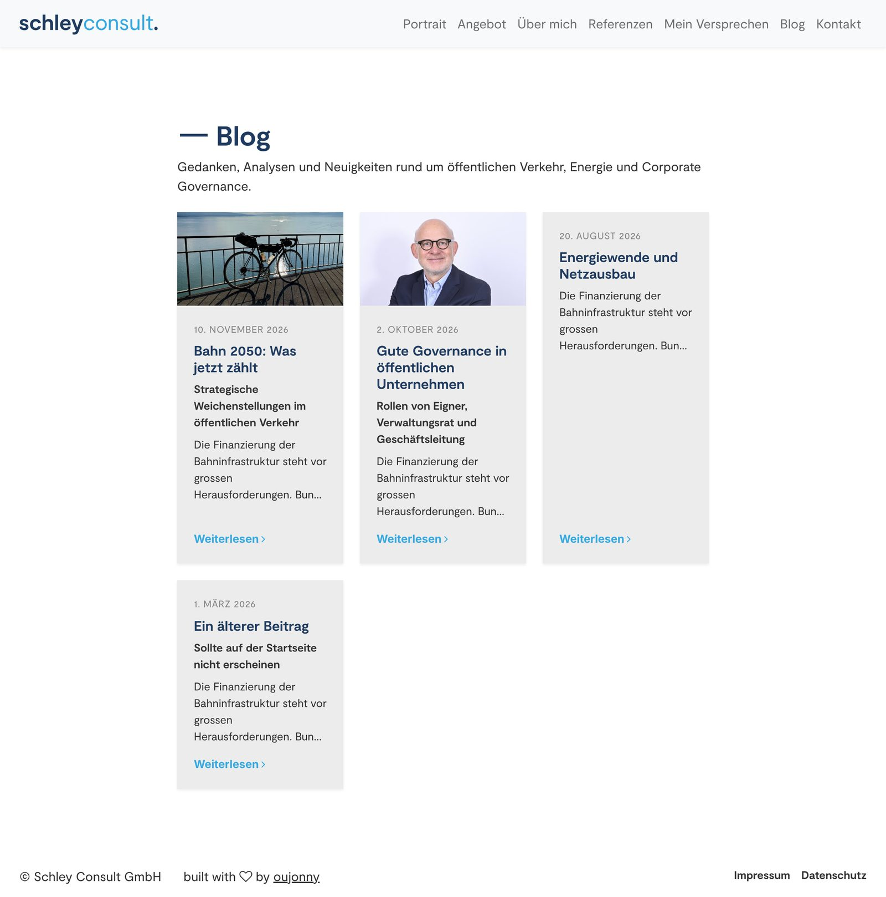
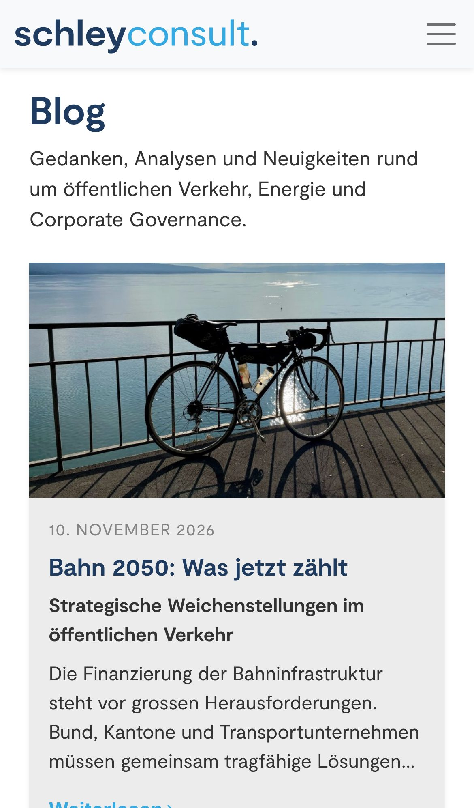
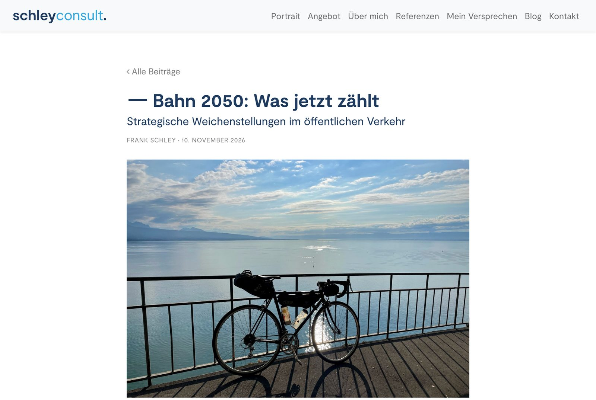
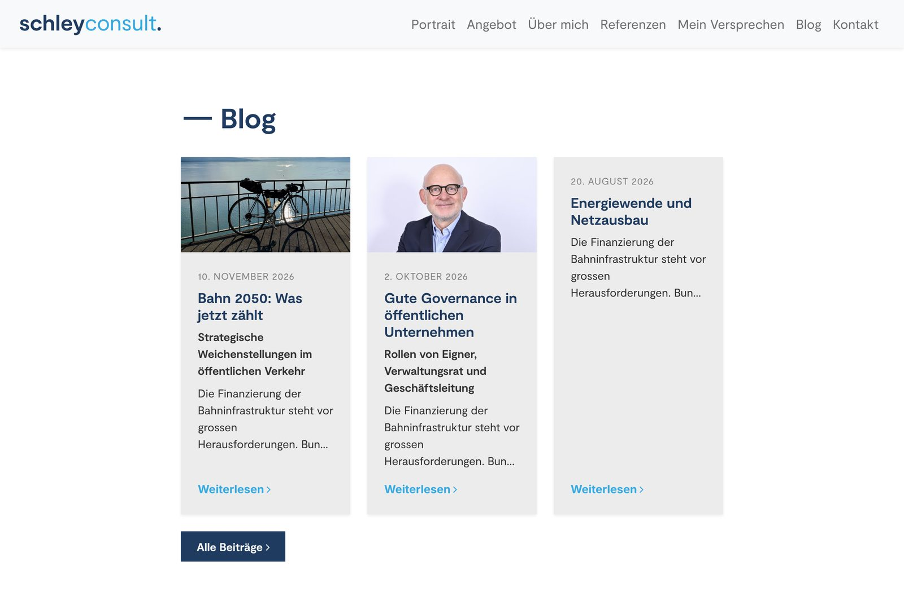

# Blog

The blog has three parts:

1. **Posts** — one page per post at `/blog/<slug>/`
2. **Overview** — all posts as cards at `/blog/`
3. **Homepage section** — the 3 newest posts, with a link to the overview

## Writing a post

In the CMS (`/admin/`) open **Blog → Neuer Blog**:

| Field | Shown where |
|-------|-------------|
| **Titel** | Post page, card |
| **Untertitel** | Post page, card (optional) |
| **Autor** | Post page (default: Frank Schley) |
| **Datum** | Post page, card; also sets the order (newest first) |
| **Bild** | Cover image on the post page and on the card (optional) |
| **Inhalt** | The text. The first ~70 words become the card summary |
| **PDF-Downloads** | See [PDFs in blog posts](pdf.md) |

Then follow the normal editorial workflow (save → "Vorschau ansehen" → publish),
see the main [README](../README.md#editorial-workflow-draft--review--publish).

**Cover images** are cropped automatically to 16:9 for the cards. The crop
picks the most interesting part of the picture, so faces stay in frame. The
post page shows the full width, up to a maximum height.

## Overview page `/blog/`

- Cards show cover image, date, title, subtitle, a short summary and
  "Weiterlesen". The whole card is clickable.
- Three per row on desktop, two on tablets, one on phones.
- The card design reuses the existing cards from "Angebot"
  (light grey, navy on hover).
- The intro text ("Gedanken, Analysen …") is editable in the CMS under
  **Statische Seiten → Blog-Übersicht**.

## Post page

Shows a "‹ Alle Beiträge" link back to the overview, title, subtitle, author,
date (in German), cover image, text and PDF downloads.

## Homepage section

- Sits between "Mein Versprechen" and "Kontakt" and has its own **Blog** menu
  item.
- Always shows the **3 newest** posts and an **Alle Beiträge** button.
- **Hidden automatically while there are no posts**, both the section and the
  menu item. It appears with the first published post.
- Title and an optional intro text: CMS → **Homepage → Blog (Startseite)**.
- Position: `weight: 6` in `content/homepage/blog.md` ("Kontakt" was moved
  to 7).

## For maintainers

| File | Purpose |
|------|---------|
| `content/blog/_index.md` | Overview title + intro. Also makes cover images in `content/blog/` publishable |
| `content/homepage/blog.md` | Homepage section (`type: blog_teaser`) |
| `themes/business/layouts/blog/list.html` | Overview page |
| `themes/business/layouts/blog/single.html` | Post page |
| `themes/business/layouts/partials/components/blog_card.html` | One card |
| `themes/business/layouts/partials/components/blog_grid.html` | Card grid |
| `themes/business/layouts/partials/components/blog_teaser.html` | Homepage section content |
| `themes/business/layouts/partials/utils/blog_image.html` | Finds a post's cover image |
| `themes/business/layouts/partials/utils/date_de.html` | German date ("10. November 2026") |
| `themes/business/static/css/style.css` | Styles, section `blog` |

The CMS blog collection filters on `layout: post`, so the overview page
(`_index.md`) doesn't show up as a post.
