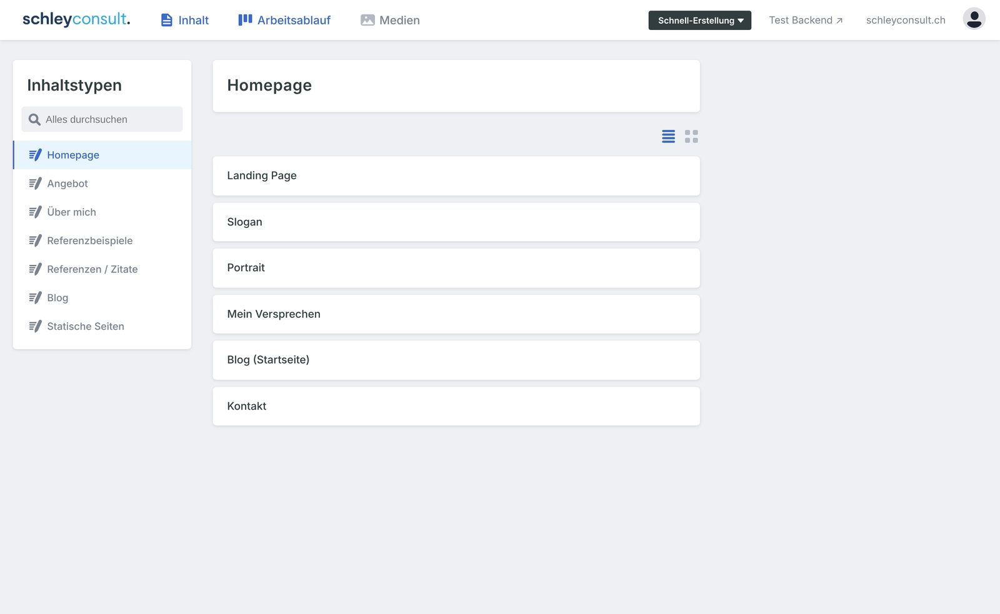
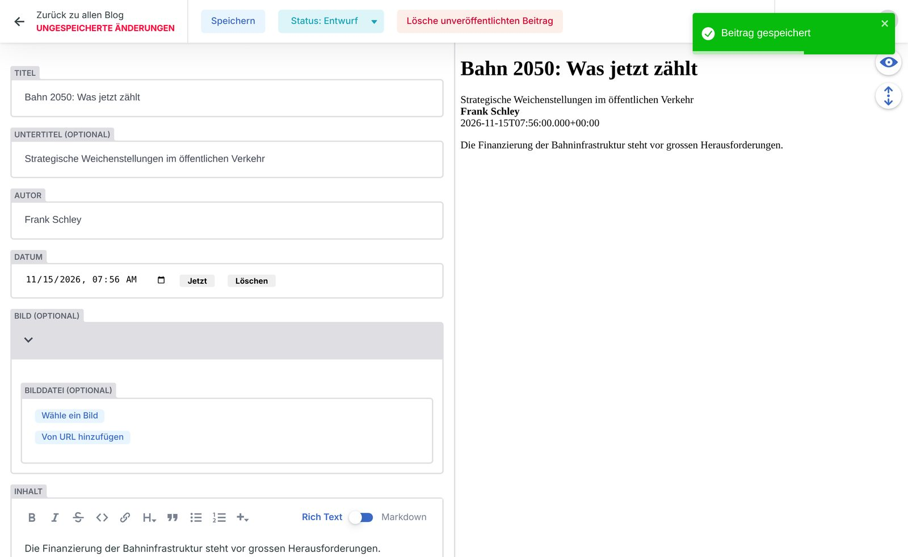
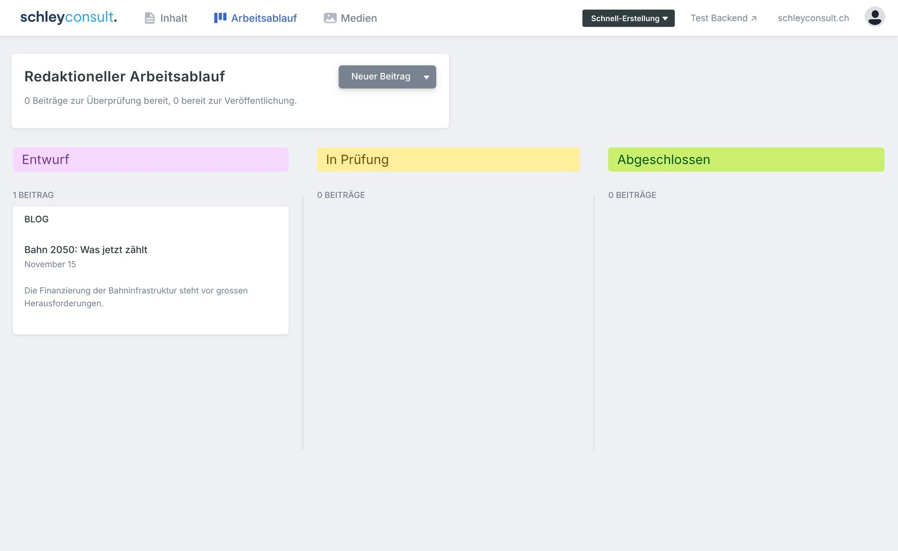

# Using the CMS

The CMS is where all website texts, images and blog posts are edited.

## 1. Log in

1. Open **<https://schleyconsult.ch/admin/>**
2. Click **Login with GitHub**. You need a GitHub account with access to the
   website repository.

> **Safari:** after logging in, a small window may stay open showing
> "✓ Anmeldung erfolgreich". Just close it, you're logged in.

## 2. Find what you want to edit

The top bar has three tabs:

- **Inhalt** – all content, grouped on the left
- **Arbeitsablauf** – drafts waiting to be published (see step 4)
- **Medien** – all uploaded images and files

Where each part of the website is edited:

| On the website | In the CMS |
|----------------|------------|
| Header image, slogan, Portrait, Mein Versprechen, Kontakt | **Homepage** |
| Angebot (the cards) | **Angebot** |
| Über mich | **Über mich** + **Referenzbeispiele** |
| Referenzen (quotes) | **Referenzen / Zitate** |
| Blog posts | **Blog** |
| Blog overview intro, Impressum, Datenschutz | **Statische Seiten** |

## 3. Edit

- Fields are on the left, a rough preview is on the right.
- Fields marked **(optional)** can stay empty.
- **Text:** use the toolbar for bold, lists, links, headings. "+" adds an
  image or a PDF link.
- **Images and files:** click "Wähle ein Bild" / "Wählen Sie eine Datei", then
  upload or pick an existing one.
- Click **Speichern** to save. Saving does **not** change the live website yet.

For blog posts and PDFs, see [Blog](blog.md) and [PDFs](pdf.md).

## 4. Check and publish

Every saved change is a **draft** first:

1. **Entwurf** – saved, still being worked on.
2. **In Prüfung** (status "Zur Überprüfung") – ready to be checked. 2–3
   minutes after saving, click **Vorschau ansehen** at the top of the entry:
   it opens the page on **preview.schleyconsult.ch**, exactly as it will look
   when published.
3. **Abgeschlossen** – approved, ready to go live.
4. In the entry, click **Veröffentlichen → Jetzt veröffentlichen**.
   After a few minutes the change is live on **schleyconsult.ch**.

Change the status with the **Status** button at the top of the entry, or drag
the card on the **Arbeitsablauf** board.

**Changed your mind?** Click **Lösche unveröffentlichten Beitrag**. The draft
is removed and nothing reaches the website.

## Good to know

- The preview site shows only **one** draft at a time: whichever was saved
  most recently.
- Always edit on **schleyconsult.ch/admin/**. `beta.schley.ch` is the
  developer's test site; its `/admin` just redirects here.
- Nothing can break the live site by accident; only **Veröffentlichen**
  changes it.
- Something wrong after publishing? Edit it again and publish the fix. Every
  change is kept in the history and can be restored by a maintainer.
