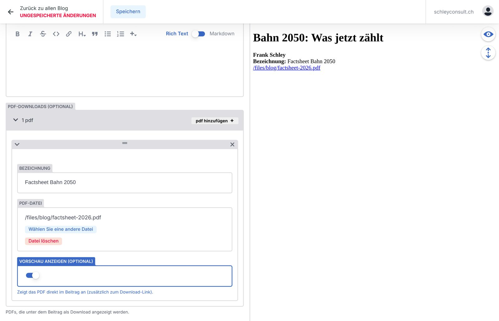
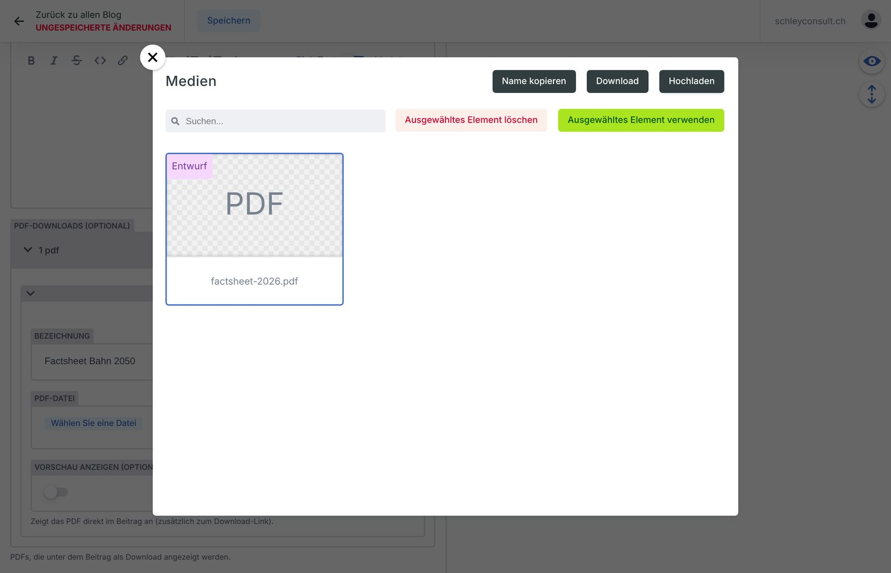
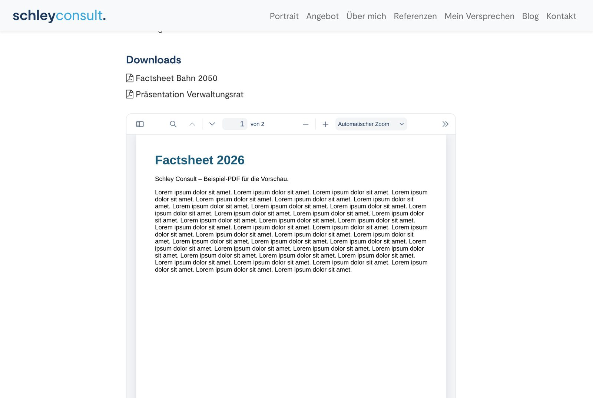
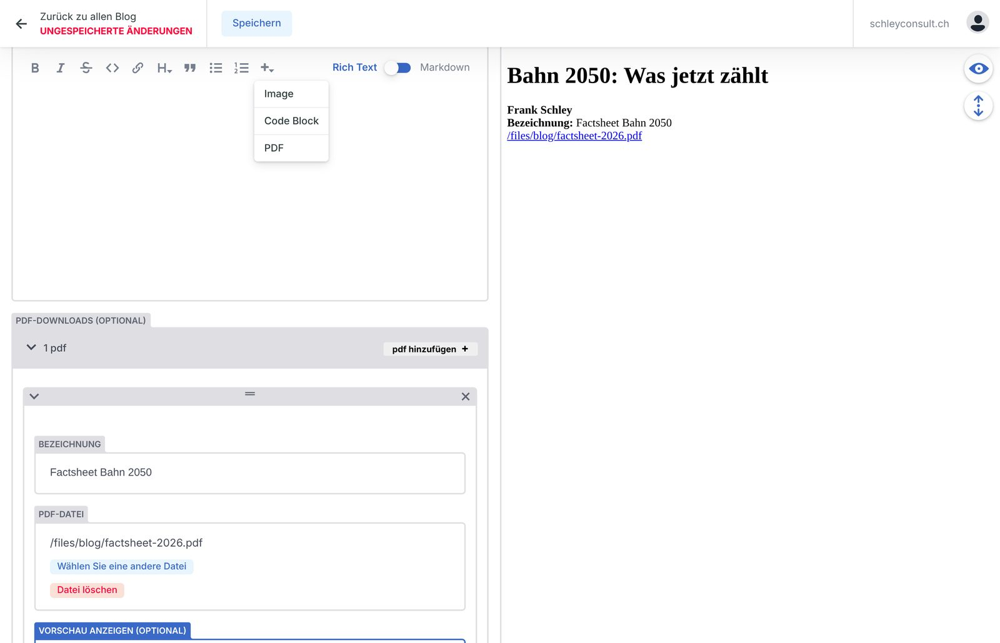

# PDFs in blog posts

There are two ways to add a PDF to a blog post:

| | Where it appears | Preview possible |
|-|------------------|------------------|
| **PDF-Downloads** list (recommended) | "Downloads" section below the post text | Yes |
| **"PDF" button** in the text editor | As a link anywhere in the text | No |

## 1. PDF-Downloads list

At the bottom of a blog post in the CMS, click **pdf hinzufügen**:

| Field | Meaning |
|-------|---------|
| **Bezeichnung** | Link text, e.g. "Factsheet 2026". If empty, the file name is used |
| **PDF-Datei** | Upload or choose a PDF (only `.pdf` is accepted) |
| **Vorschau anzeigen** | Also show the PDF directly in the post (see below) |

Uploading opens the media library. Upload a new file or pick an existing one,
then click **Ausgewähltes Element verwenden**:

- Files are stored in `static/files/blog/` and served at `/files/blog/…`.
- File names are cleaned up automatically (`Jahres Bericht.pdf` →
  `jahres-bericht.pdf`).
- Entries can be reordered by dragging (≡) and removed with ×.

### PDF preview on the website

With **Vorschau anzeigen** switched on, the PDF is shown in a viewer below the
download list, so visitors can read it without downloading:

- Uses Mozilla's **PDF.js** viewer (the same viewer as in Firefox), restyled in
  the site colours, with its editing tools hidden.
- Works on desktop and phones. Visitors can scroll, zoom, search and go
  full screen.
- The controls follow the visitor's browser language (German, French,
  Italian; otherwise English).
- The viewer is served from our own server; nothing is loaded from third
  parties.

## 2. "PDF" button in the text

To link a PDF in the middle of the text, use **+ → PDF** in the editor toolbar:

Enter a link text and choose a file. It's saved as a normal link.

> In this spot the CMS ignores the PDF folder setting, so these files land in
> `static/images/` instead of `static/files/blog/`. The links work fine; it's
> just a different folder. This is a limitation of Decap CMS.

## For maintainers

| File | Purpose |
|------|---------|
| `static/admin/config.yml` | `downloads` field on the blog collection |
| `static/admin/index.html` | The custom "PDF" editor button (`registerEditorComponent`) |
| `themes/business/layouts/partials/components/downloads.html` | Download list + preview |
| `static/pdfjs/` | Vendored PDF.js viewer (~9 MB, committed) |
| `themes/business/static/css/pdfjs-theme.css` | Viewer theme (overrides PDF.js CSS variables) |
| `scripts/fetch-pdfjs.sh` | Updates `static/pdfjs/` |

**What's reused vs. custom:**

- Downloads list → Decap's built-in `list` + `file` widgets (configuration only).
- PDF viewer → Mozilla PDF.js, unmodified, plus our theme CSS.
- Custom code: the Hugo partial (~30 lines), the theme CSS and the "PDF" editor
  button (~25 lines, nothing equivalent exists in the Decap community).

**Updating PDF.js:**

1. Pick a release on <https://github.com/mozilla/pdf.js/releases>.
2. Set `PDFJS_VERSION` and `PDFJS_SHA256` (the SHA-256 of
   `pdfjs-<version>-dist.zip`) in `scripts/fetch-pdfjs.sh`.
3. Run `bash scripts/fetch-pdfjs.sh`. It checks the checksum, removes source
   maps, debug files, the sample PDF and unneeded languages, and hooks in the
   theme.
4. Check a preview. If Mozilla renamed CSS variables, the viewer still works
   but looks like stock PDF.js until `pdfjs-theme.css` is adjusted.
5. Commit `static/pdfjs/`.

**Why PDF.js and not something else** (evaluated Nov 2026):

| Option | Verdict |
|--------|---------|
| Browser's built-in PDF viewer (`<object>`/`<iframe>`) | Shows nothing on many phones (especially Android) |
| `hugo-embed-pdf-shortcode` | Unmaintained since 2023; bundles PDF.js 3.4, which has a known security flaw (CVE-2024-4367) |
| EmbedPDF | Modern look, but a newer and smaller project, and it loads data from the jsDelivr CDN (privacy) |
| **Mozilla PDF.js viewer + theme** | Chosen: maintained by Mozilla, works everywhere, self-hosted |
